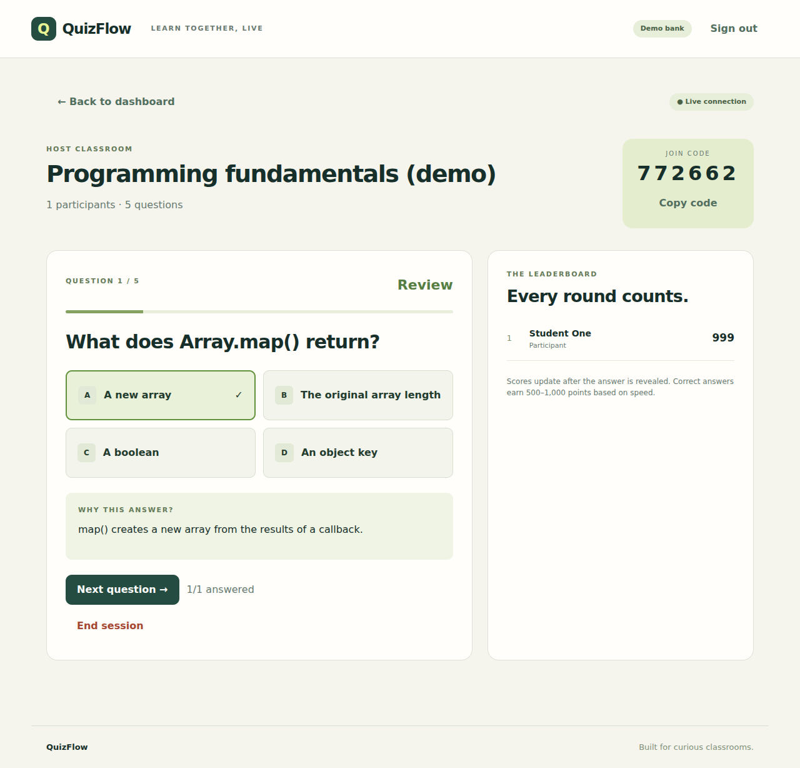

# QuizFlow

A full-stack classroom quiz platform with AI-assisted question creation, authenticated teacher accounts, real-time sessions, and persistent results.

React + Vite · Node.js + Express · PostgreSQL · Socket.IO · Gemini REST API



[Teacher studio screenshot](docs/teacher-studio.png)

## Run on your Mac in VS Code

Install **Node.js 22.12 or later** and **Docker Desktop**, and start Docker Desktop. Extract `quizflow.zip`. The extracted project folder is named `quizflow`. Open that exact folder in VS Code; it contains the root `package.json`.

In the VS Code terminal (from `quizflow`):

```bash
node -v
npm -v
docker --version
npm ci
npm run setup
docker compose up -d db
npm run db:migrate
npm run dev
```

Open **http://localhost:5173**. Keep the terminal running. Use `localhost`, not `127.0.0.1`, so the configured development origin matches.

The app starts in **demo mode** without an API key. The fixed question bank covers programming fundamentals: up to 10 multiple-choice or 5 true/false questions. Topic and difficulty controls apply to Gemini, not the demo bank. Demo failures never silently masquerade as AI output.

## Try a live quiz

1. Select **Teacher studio**, create an account (password at least 10 characters), and load demo questions.
2. Review or edit questions, correct answers, and explanations. Click **Save quiz**, then **Host live**.
3. Open a separate browser or an incognito window. Go to the same URL, enter the six-digit code and a student name.
4. Start the quiz from the teacher window. Answer from the student window.
5. Reveal the answer, move to the next question, and finish the quiz. Download results as CSV.
6. Sign in later to reopen session history. A participant can reload their session using their browser cookie.

A teacher account and participant identity use separate HttpOnly cookies. Each browser profile holds one current participant session. Separate browser profiles simulate separate students.

## Enable real Gemini generation

Create a key at https://aistudio.google.com/apikey. Keep it only in `server/.env`:

```dotenv
AI_PROVIDER=gemini
GEMINI_API_KEY=your_key_here
GEMINI_MODEL=gemini-3.8-flash
```

Restart `npm run dev` after changing environment variables. Select a topic, difficulty and count, and choose **Generate with Gemini**. Model availability and quota depend on your Google account; change `GEMINI_MODEL` if AI Studio shows a different supported model. API use can incur charges based on your account and model.

The provider requests structured JSON, validates shape, bounds, option uniqueness, correct-answer indexes, and question uniqueness, and retries malformed output or transient server/network failures once. It has a 60-second timeout per request. No API key enters the React bundle. AI errors remain visible; there is no automatic demo fallback.

Official API references: [structured outputs](https://ai.google.dev/gemini-api/docs/generate-content/structured-output), [models](https://ai.google.dev/gemini-api/docs/models).

## Commands

Run all commands below from the root `quizflow` directory:

```bash
# Start both frontend and API during development
npm run dev

# Run tests (no Docker or API key required)
npm test

# Compile the production frontend
npm run build

# Apply the PostgreSQL schema
npm run db:migrate

# Stop the database while keeping saved data
docker compose stop db

# Restart the database
docker compose up -d db

# Inspect API health, in another terminal
curl http://localhost:3000/api/health
```

Stop the dev process with `Ctrl+C` before stopping the database. Do not run `docker compose down -v` unless you want to permanently delete your local database volume.

### Run the compiled application locally with Docker

Use the same `server/.env` with a generated JWT secret, then:

```bash
docker compose --profile full up --build
```

Open **http://localhost:3000**. This profile serves the compiled frontend, API and Socket.IO from one origin. It deliberately enables HTTP cookies only for the exact localhost Docker origin. `LOCAL_DOCKER` must never be enabled on a public deployment. Do not run the dev API on port 3000 at the same time.

## Deployment

See [docs/DEPLOYMENT.md](docs/DEPLOYMENT.md) for Render and generic Docker deployment. The ZIP includes a Dockerfile and `render.yaml` Blueprint. PostgreSQL persists users, quizzes and sessions; the API can restart without losing quiz progress.

Deploy **one backend replica** initially. Socket.IO notifications and request limits are process-local. More replicas require a shared Socket.IO adapter, shared rate-limit store, and sticky routing or WebSocket-only clients. Server-side deadlines survive restart; expiry is reconciled when clients fetch state. The teacher advances questions explicitly.

This release supports multiple-choice and true/false quizzes, up to 20 questions and 100 participants per session. It does not include short-answer AI grading, password reset/email verification, classroom organization roles, or horizontal scaling. It is a deployable portfolio v1, not a claim of audited production readiness.

## Structure

```text
quizflow/
  client/src/       React teacher, student and live-session interfaces
  server/src/      Express API, auth, quiz domain logic, Gemini, PostgreSQL
  server/test/     Domain, AI and API/WebSocket integration tests
  docs/            Architecture, API, deployment, resume notes
  Dockerfile
  docker-compose.yml
  render.yaml
  package-lock.json
```

## Verification

`npm test` runs seven tests, including a full two-participant flow with real SQL on PGlite (PostgreSQL compiled to WASM). It checks authentication, ownership, origin restrictions, answer hiding, duplicate submission, scoring, CSV export and Socket.IO notifications. PGlite is test-only; deployment uses PostgreSQL through `pg`.

The frontend production build and a two-browser UI smoke test were also checked. Live Gemini requests, external deployment, and Docker image execution require your credentials/runtime and were not exercised in the build environment.

## Interview and resume preparation

See [docs/RESUME.md](docs/RESUME.md). Understand the scoring rules, transactional answer submission and answer visibility before presenting the project. Add your actual deployed URL and GitHub URL; do not claim traffic or measured scale you have not tested.
