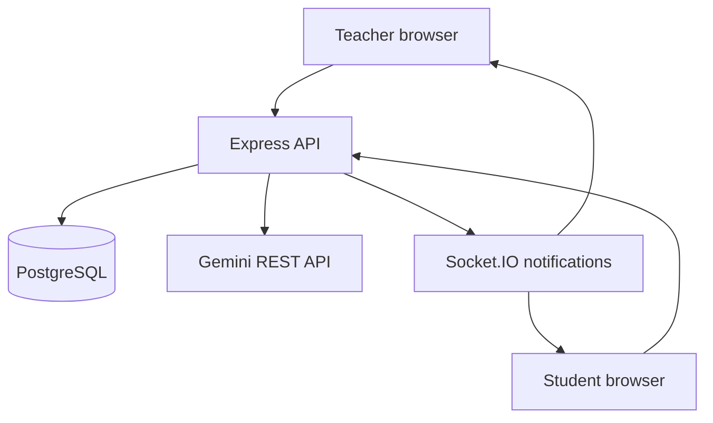

# QuizFlow v1 architecture

This replaces the supplied single-HTML prototype and its browser-memory sessions. There is no direct Claude call or CDN React dependency.

## Session state and scoring

Teachers authenticate with bcrypt password hashes and a seven-day JWT in an HttpOnly cookie (Secure in production, SameSite=Lax). A participant joins without a teacher account and receives a separately signed HttpOnly cookie containing their session code and random participant ID. The code alone does not authorize reads or answers after joining.

A quiz stores reviewed questions and the correct answers. A session snapshots its quiz and follows `lobby → active → review → active … → finished`. Teachers explicitly reveal/advance/end. At the authoritative server deadline, reads render review even if no explicit reveal happened. Late answers are rejected. A quiz cannot accept new participants after starting; existing participants can rejoin using their cookie.

Answers are submitted with a question index. `SELECT … FOR UPDATE` serializes session mutations inside PostgreSQL transactions. Duplicate submissions cannot score twice, and answers against a previous index cannot be accepted. Host controls include a session version to prevent a stale/double click from moving through two questions. Transactions cover session changes, not external AI calls.

A correct answer earns `500 + round(500 × fraction_of_time_remaining)`; incorrect answers earn zero. A round's answer index, explanation, points and score changes are hidden from participants until reveal or expiry. The backend strips private fields from snapshots. Teachers can see answers in their saved quiz but participants never receive unrevealed correct answers.

Socket.IO rooms are authorized using the browser cookies. Events carry only a "session changed" notification; clients fetch an authorized REST snapshot. A three-second reconciliation poll catches missed events, reconnects and deadline expiry. Clients estimate clock offset using server time and display a countdown; only the server accepts/rejects answers.

## Data model

| Table | Key | Purpose |
| --- | --- | --- |
| users | UUID id | Teacher name, unique email and password hash |
| quizzes | UUID id | Owner, title, question JSONB, source, round duration |
| sessions | Six-digit code | Owner, quiz reference, immutable question snapshot and mutable session JSONB |

`owner_id` and `quiz_id` use foreign keys; owner indexes support history queries. JSONB keeps quiz/session aggregates simple for portfolio v1. A session row lock serializes every player answer, so this design targets small classrooms rather than high-volume events. Normalize participants/answers and reduce lock contention for larger deployments.

## AI boundary

A provider switch selects explicit `demo` or `gemini` mode. Gemini requests a JSON Schema and the server validates output with Zod before returning it for teacher review. The key is sent in a server-side request header. Network/transient errors and malformed data retry once; authentication/quota failures are visible. The demo is a curated programming bank, not a topic-aware AI substitute.

## Security and practical limits

- Same-origin API with request-origin and Fetch Metadata checks. Vite proxies development requests; Express serves production assets.
- Helmet headers, JSON body-size limits, request/authentication/generation rate limits, bounded input validation, parameterized SQL and ownership checks.
- No password reset, email verification, invitations or organization-level roles in v1.
- Logout clears the teacher cookie; JWTs are stateless and expire in seven days. Immediate revocation/session management is future work.
- All teacher registrations can create quizzes; there is no administrative approval system.
- Sessions support 100 participants and 20 questions; these are application limits, not a claim of load-test results.
- One backend replica; multi-instance WebSocket fanout and shared rate limiting are future work.
- Add monitoring, backups, versioned migrations and operational load tests before relying on this for a real institution.

## Tests

Domain tests cover scoring, timer boundaries, duplicate/stale answer rejection, hidden answer visibility and schema validation. Provider tests use injected HTTP responses for valid/invalid output and quota errors. API integration tests execute real PostgreSQL SQL via PGlite and connect a Socket.IO client. The production build is checked separately. Test coverage is behavioral; live paid provider and hosted-service integration require user credentials.
